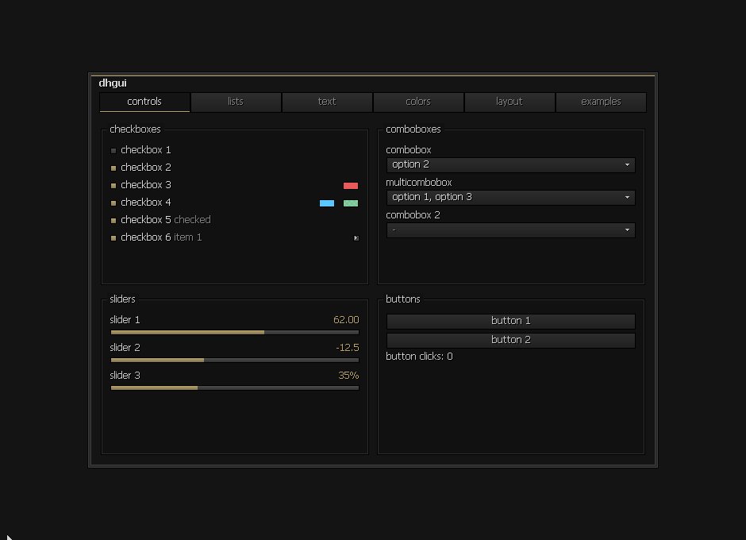

# dylanhook gui

ui framework for windows / direct3d 11, written in c++23



## build

open `tools/demo_menu/demo_menu.vcxproj` in visual studio and build release / x64

you need the v143 c++ tools and a windows sdk installed

the demo will be in `tools/demo_menu/output/Release/demo_menu.exe`

insert opens / closes the menu, drag the title to move it or the bottom right to resize it

the arrow beside checkbox 6 opens a list

the examples tab has hidden sliders, search and scrolling

## using it

add this import to your `.vcxproj`, after `IntDir` is set

```xml
<Import Project="path\to\dhgui\dh-gui.vcxitems" Label="Shared" />
```

this adds the source files and shader compilation to your project

the framework uses your `pch.h`, add your source folder to the include path so it can find it

use `tools/demo_menu/src/pch.h` for the required definitions

call these before using the framework

```cpp
if (!dh::init_private_heap()) return 1;
if (!dh::chrono::prime_qpc_frequency()) return 1;
```

it supplies global `new` / `delete`, so the heap needs to be ready before anything uses them

settings are signals, the controls read / change the same values your app uses

keep the signals alive while their controls are in use

```cpp
dh::reactive::signal<bool> enabled{false};
dh::reactive::signal<float> amount{50.0f};
dh::ui::layout::stack content{dh::ui::layout::orientation::vertical};

content.emplace<dh::ui::controls::toggle>("checkbox 1", enabled, nullptr);
content.emplace<dh::ui::controls::slider>("slider 1", amount, 0.0f, 100.0f, 1.0f, nullptr);
```

`nullptr` means no right click editor, pass your own editor factory if you need one

`tools/demo_menu/src/app.cpp` has the renderer, fonts, input and frame loop

keep the control tree on one ui thread

link the same libraries as the demo project

`d3d11`, `dxgi`, `dwrite`, `d2d1`, `windowscodecs`, `ole32`, `shell32`, `user32` and `synchronization`

the default colors and sizes are in `src/ui/theme/theme.h`

the accent is a signal too, changing it updates the menu color

## license

free to use / modify / sell under the [dhgui proprietary license](LICENSE)

read it before using the source, including the revocation terms
